# 📋 FinLearn — API Contract

> Complete reference of every HTTP endpoint, payload shape, and database schema.

---

## Base URLs

| Environment | URL |
|-------------|-----|
| Development (backend) | `http://localhost:5050` |
| Production (backend) | `https://finlearn-1.onrender.com` |
| Development (frontend) | `http://localhost:5173` |
| Production (frontend) | `https://fin-learn-client-ttsd.vercel.app` |

---

## Authentication

Most protected endpoints require an **HTTP-only `accessToken` cookie** (set at login).  
Alternatively, send `Authorization: Bearer <token>` in the header (mobile fallback).

| Status Code | Meaning |
|-------------|---------|
| `200` | Success |
| `201` | Created |
| `400` | Bad request / validation error |
| `403` | Unauthorized (missing/invalid/expired token) |
| `404` | Resource not found |
| `500` | Internal server error |

---

## 🔐 Auth Routes — `/user`

### `POST /user/register`
Create a new user account.

**Auth required:** No  
**Body:**
```json
{
  "name": "Ravi Kumar",
  "email": "ravi@example.com",
  "password": "mypassword123"
}
```
**Response `200`:**
```json
{
  "message": "Registration successful",
  "status": true,
  "user": { "id": "...", "name": "Ravi Kumar", "email": "ravi@example.com" }
}
```

---

### `POST /user/login`
Authenticate with email + password. Sets `accessToken` (7d) and `refreshToken` (30d) HTTP-only cookies.

**Auth required:** No  
**Body:**
```json
{
  "email": "ravi@example.com",
  "password": "mypassword123"
}
```
**Response `200`:**
```json
{
  "message": "Login successful",
  "status": true,
  "token": "<accessToken>",
  "user": {
    "id": "...",
    "name": "Ravi Kumar",
    "email": "ravi@example.com",
    "profileImage": null,
    "onboardingCompleted": false,
    "isAdmin": false
  }
}
```
**Error `400`:**
```json
{ "message": "No user found with this email" }
{ "message": "Incorrect password" }
{ "message": "This account was registered using Google Sign-In...", "isGoogleAccount": true }
```

---

### `GET /user/logout`
Clear auth cookies.

**Auth required:** No  
**Response `200`:**
```json
{ "message": "Logged out successfully" }
```

---

### `POST /user/refresh-token`
Exchange the `refreshToken` cookie for a new `accessToken`. Used for session persistence on Android.

**Auth required:** No (uses `refreshToken` cookie)  
**Response `200`:**
```json
{ "message": "Token refreshed", "status": true }
```

---

### `POST /user/set-token-cookies`
Exchange the short-lived OAuth exchange code for real auth cookies (Vercel domain fix).

**Auth required:** No  
**Body:**
```json
{ "code": "<exchangeCode_JWT>" }
```
**Response `200`:**
```json
{ "message": "Cookies set", "status": true, "user": { ... } }
```

---

### `GET /user/access`
Check if the current session is valid. Used by the client to hydrate auth state on page load.

**Auth required:** Yes  
**Response `200`:**
```json
{
  "status": true,
  "user": { "id": "...", "name": "...", "email": "...", "isAdmin": false }
}
```

---

### `GET /user/profile`
Fetch the full authenticated user profile.

**Auth required:** Yes  
**Response `200`:**
```json
{
  "status": true,
  "user": {
    "_id": "...",
    "name": "Ravi Kumar",
    "email": "ravi@example.com",
    "profileImage": null,
    "phone": null,
    "location": null,
    "bio": null,
    "occupation": null,
    "website": null,
    "twitter": null,
    "linkedin": null,
    "github": null,
    "xp": { "totalXP": 500, "currentXP": 500, "level": 1, "maxXPForLevel": 7500 },
    "leaderboardStats": { "completedCourses": 1, "streak": 3, ... },
    "onboarding": { "completed": true, "experience": "beginner", ... },
    "isAdmin": false,
    "status": "active",
    "createdAt": "2026-01-01T00:00:00.000Z"
  }
}
```

---

### `PUT /user/profile`
Update profile fields (name, phone, location, bio, occupation, social links, etc.).

**Auth required:** Yes  
**Body** (any subset of):
```json
{
  "name": "Ravi Kumar",
  "phone": "+91 9876543210",
  "location": "Mumbai, India",
  "bio": "Learning finance!",
  "occupation": "Student",
  "website": "https://ravi.dev",
  "twitter": "@ravi",
  "linkedin": "linkedin.com/in/ravi",
  "github": "github.com/ravi"
}
```
**Response `200`:**
```json
{ "status": true, "user": { ...updatedUser } }
```

---

### `POST /user/profile/image`
Upload a profile image (base64 encoded).

**Auth required:** Yes  
**Body:**
```json
{ "image": "data:image/jpeg;base64,..." }
```
**Response `200`:**
```json
{ "status": true, "profileImage": "data:image/jpeg;base64,..." }
```

---

### `POST /user/password/forget`
Trigger OTP email for password reset.

**Auth required:** No  
**Body:**
```json
{ "email": "ravi@example.com" }
```
**Response `200`:**
```json
{ "message": "OTP sent to your email", "status": true }
```

---

### `POST /user/otp/verify`
Verify the password-reset OTP.

**Auth required:** No  
**Body:**
```json
{ "email": "ravi@example.com", "otp": 123456 }
```
**Response `200`:**
```json
{ "status": true, "verified": true }
```

---

### `GET /user/otp/exp`
Get OTP expiry timestamp for the authenticated user (for countdown timer UI).

**Auth required:** Yes  
**Response `200`:**
```json
{ "status": true, "expiresAt": 1700000000000 }
```

---

### `POST /user/password/update`
Set a new password after OTP verification.

**Auth required:** Yes (or verified via OTP flow)  
**Body:**
```json
{ "email": "ravi@example.com", "newPassword": "newSecurePass123" }
```
**Response `200`:**
```json
{ "message": "Password updated successfully", "status": true }
```

---

### `POST /user/profile/email/send-otp`
Send OTP to verify a new email address.

**Auth required:** Yes  
**Body:**
```json
{ "newEmail": "new@example.com" }
```
**Response `200`:**
```json
{ "message": "OTP sent to new email", "status": true }
```

---

### `POST /user/profile/email/verify-otp`
Confirm the new email via OTP. Updates `user.email` on success.

**Auth required:** Yes  
**Body:**
```json
{ "otp": 654321 }
```
**Response `200`:**
```json
{ "message": "Email updated", "status": true }
```

---

### `POST /user/onboarding`
Save onboarding preferences after first login.

**Auth required:** Yes  
**Body:**
```json
{
  "experience": "beginner",
  "goals": ["save money", "invest better"],
  "timeCommitment": "3-5 hours/week",
  "learningStyle": "interactive",
  "currentSituation": "employed",
  "priority": "emergency fund"
}
```
**Response `200`:**
```json
{ "status": true, "message": "Onboarding saved" }
```

---

### `POST /user/onboarding/skip`
Mark onboarding as skipped/completed without saving answers.

**Auth required:** Yes  
**Response `200`:**
```json
{ "status": true, "message": "Onboarding skipped" }
```

---

### `GET /user/leaderboard`
Fetch the ranked leaderboard of all users by XP/completions/streaks.

**Auth required:** Yes  
**Response `200`:**
```json
{
  "status": true,
  "leaderboard": [
    {
      "rank": 1,
      "name": "Ravi Kumar",
      "xp": { "totalXP": 5000, "level": 3 },
      "leaderboardStats": { "completedCourses": 5, "streak": 10 }
    }
  ]
}
```

---

## 📚 Course Routes — `/courses`

### `GET /courses`
Get all published courses. Enriched with user's enrollment/progress if logged in.

**Auth required:** Optional (optionalAuth)  
**Response `200`:**
```json
{
  "success": true,
  "courses": [
    {
      "_id": "...",
      "title": "Budgeting Basics",
      "slug": "budgeting-basics",
      "category": "Budgeting",
      "difficulty": "Beginner",
      "thumbnail": null,
      "instructor": "FinanceQuest Team",
      "duration": 120,
      "rating": 4.8,
      "totalEnrollments": 150,
      "isPublished": true,
      "enrolled": true,
      "progress": 45,
      "xpEarned": 200,
      "completed": false,
      "completedAt": null,
      "certificateIssued": false,
      "lessonsCompleted": 3,
      "lessonsTotal": 8
    }
  ]
}
```

> **Note:** `modules[].lessons[].content` and `modules[].lessons[].quiz` are stripped from the list response for performance.

---

### `GET /courses/:courseId`
Get full course content + user's progress. Auto-creates progress record on first authenticated visit.

**Auth required:** Optional  
**Params:** `courseId` — MongoDB ObjectId  
**Response `200`:**
```json
{
  "success": true,
  "course": {
    "_id": "...",
    "title": "Budgeting Basics",
    "modules": [
      {
        "id": "m1",
        "title": "Module 1: Introduction",
        "order": 1,
        "xpReward": 100,
        "lessons": [
          {
            "id": "l1",
            "title": "What is a Budget?",
            "duration": 15,
            "xpReward": 20,
            "content": "<p>HTML content...</p>",
            "videoUrl": null,
            "resources": [],
            "quiz": { "questions": [ { "id": "q1", "question": "...", "options": [...], "correctAnswer": 0 } ] }
          }
        ]
      }
    ]
  },
  "progress": {
    "overallProgress": 25,
    "totalXPEarned": 100,
    "isCompleted": false,
    "modules": [ { "moduleId": "m1", "unlocked": true, "lessons": [...] } ]
  }
}
```

---

### `PUT /courses/:courseId/lesson/:lessonId/complete`
Mark a lesson as complete and award XP to the user.

**Auth required:** Yes  
**Params:** `courseId`, `lessonId`  
**Body:**
```json
{
  "xpEarned": 20,
  "score": 85
}
```
**Response `200`:**
```json
{
  "success": true,
  "progress": { "overallProgress": 50, "totalXPEarned": 220, ... }
}
```

---

### `PUT /courses/:courseId/module/:moduleId/complete`
Mark a module complete (after passing quiz). Awards XP, unlocks next module, and issues certificate if course is done.

**Auth required:** Yes  
**Params:** `courseId`, `moduleId`  
**Body:**
```json
{ "quizScore": 90 }
```
**Response `200`:**
```json
{
  "success": true,
  "progress": { "isCompleted": true, "certificateIssued": true, "verificationId": "FL-XXXX" },
  "courseCompleted": true
}
```

---

### `GET /courses/:courseId/certificate`
*(Disabled — returns 501)* Server-side PDF generation is disabled; use frontend download.

**Auth required:** Yes  
**Response `501`:**
```json
{ "success": false, "message": "Server-side PDF generation is disabled. Please use the frontend download." }
```

---

## 🏅 Certificate Routes — `/certificates`

### `GET /certificates/verify/:verifyId`
Public endpoint to verify a certificate by its unique verification ID.

**Auth required:** No  
**Params:** `verifyId` — Uppercase alphanumeric ID (e.g. `FL-ABCD1234`)  
**Response `200`:**
```json
{
  "success": true,
  "studentName": "Ravi Kumar",
  "courseName": "Budgeting Basics",
  "completedAt": "2026-10-01T12:00:00.000Z",
  "verificationId": "FL-ABCD1234",
  "profileImage": null
}
```
**Response `404`:**
```json
{ "success": false, "message": "No certificate found for this verification ID." }
```

---

### `GET /certificates/og-meta/:verifyId`
Alias of `/certificates/verify/:verifyId` — used for OG meta tag rendering.

---

### `GET /certificates/issue/:courseId`
Issue/refresh a certificate for a completed course. Returns the same certificate payload.

**Auth required:** Yes  
**Params:** `courseId`  
**Response `200`:**
```json
{
  "success": true,
  "studentName": "Ravi Kumar",
  "courseName": "Budgeting Basics",
  "completedAt": "2026-10-01T12:00:00.000Z",
  "verificationId": "FL-ABCD1234"
}
```

---

## 🤖 Chat Routes — `/api`

### `POST /api/chat`
Send a message to FinBot (AI financial assistant). Maintains conversation history per session.

**Auth required:** No  
**Body:**
```json
{
  "message": "What is SIP investing?",
  "sessionId": "uuid-v4-session-id"
}
```
**Response `200`:**
```json
{
  "reply": "SIP (Systematic Investment Plan) is a method of investing a fixed amount regularly in mutual funds...",
  "sessionId": "uuid-v4-session-id"
}
```
**Error `429`:** AI rate limit exceeded  
**Error `401`:** Invalid OpenRouter API key

---

## 🛡️ Admin Routes — `/admin`

> All admin routes require both `auth` middleware (valid JWT) **and** `adminOnly` middleware (`user.isAdmin === true`).

### Courses CRUD

| Method | Endpoint | Description |
|--------|----------|-------------|
| `GET` | `/admin/courses` | List all courses (including unpublished) |
| `GET` | `/admin/courses/:id` | Get single course |
| `POST` | `/admin/courses` | Create new course |
| `PUT` | `/admin/courses/:id` | Update course |
| `DELETE` | `/admin/courses/:id` | Delete course |

**POST/PUT Course Body:**
```json
{
  "title": "Intro to Investing",
  "slug": "intro-to-investing",
  "description": "Learn the basics of stock market investing.",
  "category": "Investing",
  "difficulty": "Beginner",
  "thumbnail": null,
  "instructor": "FinanceQuest Team",
  "isPublished": true,
  "modules": [
    {
      "id": "m1",
      "title": "Module 1",
      "order": 1,
      "xpReward": 100,
      "description": "Introduction",
      "lessons": [
        {
          "id": "l1",
          "title": "Lesson 1",
          "duration": 15,
          "xpReward": 20,
          "content": "<p>Content here</p>",
          "videoUrl": null,
          "resources": [],
          "quiz": { "questions": [] }
        }
      ]
    }
  ]
}
```

**Category enum:** `Savings | Investing | Budgeting | Debt | Retirement | Tax`  
**Difficulty enum:** `Beginner | Intermediate | Advanced`

---

### Users Management

| Method | Endpoint | Description |
|--------|----------|-------------|
| `GET` | `/admin/users` | List all users (selected fields) |
| `GET` | `/admin/users/:id` | Get single user |
| `PUT` | `/admin/users/:id/xp` | Add or deduct XP |
| `PUT` | `/admin/users/:id/ban` | Toggle ban/unban |
| `PUT` | `/admin/users/:id/reset` | Reset user XP to 0 |

**PUT /admin/users/:id/xp Body:**
```json
{ "op": "add", "amount": 500 }
{ "op": "deduct", "amount": 100 }
```

---

### Quizzes CRUD

| Method | Endpoint | Description |
|--------|----------|-------------|
| `GET` | `/admin/quizzes` | List all quizzes |
| `GET` | `/admin/quizzes/:id` | Get single quiz |
| `POST` | `/admin/quizzes` | Create new quiz |
| `PUT` | `/admin/quizzes/:id` | Update quiz |
| `DELETE` | `/admin/quizzes/:id` | Delete quiz |

**POST/PUT Quiz Body:**
```json
{
  "title": "Budgeting Quiz 1",
  "description": "Test your budgeting knowledge",
  "category": "Budgeting",
  "difficulty": "Beginner",
  "timeLimit": 10,
  "passingScore": 70,
  "xpReward": 50,
  "isPublished": true,
  "questions": [
    {
      "id": "q1",
      "question": "What is the 50/30/20 rule?",
      "options": ["A budgeting rule", "A tax rule", "An investing rule", "None"],
      "correctAnswer": 0,
      "explanation": "The 50/30/20 rule divides income into needs, wants, and savings.",
      "xpReward": 10
    }
  ]
}
```

---

## 🔑 Google OAuth Routes (defined in `googleStrategy.js`)

| Method | Endpoint | Description |
|--------|----------|-------------|
| `GET` | `/auth/google` | Initiate Google OAuth flow |
| `GET` | `/auth/google/callback` | Google OAuth callback (redirects to frontend) |

---

## 🏥 Health Check

| Method | Endpoint | Description |
|--------|----------|-------------|
| `GET` | `/` | API health check |

**Response `200`:**
```json
{
  "status": "online",
  "message": "Financial Literacy Hub API is running",
  "version": "1.0.0",
  "timestamp": "2026-11-05T15:41:00.000Z"
}
```

---

## 🗄️ Database Schema — ER Diagram

```mermaid
erDiagram
    User {
        ObjectId _id PK
        String name
        String email UK
        String password
        String profileImage
        String phone
        String location
        String bio
        String occupation
        String website
        String twitter
        String linkedin
        String github
        Number xp_totalXP
        Number xp_currentXP
        Number xp_level
        Number xp_maxXPForLevel
        Number leaderboardStats_completedCourses
        Number leaderboardStats_completionRate
        Number leaderboardStats_streak
        Number leaderboardStats_longestStreak
        Date leaderboardStats_lastActivityDate
        Number leaderboardStats_rank
        Number password_otp_otp
        Number password_otp_time
        Number password_otp_attempts
        Boolean password_otp_status
        Number email_otp_otp
        String email_otp_newEmail
        Boolean email_otp_status
        Boolean onboarding_completed
        String onboarding_experience
        Array onboarding_goals
        String onboarding_timeCommitment
        String onboarding_learningStyle
        String onboarding_currentSituation
        String onboarding_priority
        String status
        Boolean isAdmin
        Date createdAt
        Date updatedAt
    }

    Course {
        ObjectId _id PK
        String title
        String slug UK
        String courseId
        String description
        String category
        String difficulty
        String thumbnail
        String instructor
        Number duration
        Number rating
        Number totalEnrollments
        Boolean isPublished
        Array modules
        Array prerequisites
        Date createdAt
        Date updatedAt
    }

    Module {
        String id PK
        String title
        Number order
        String description
        Number xpReward
        Array lessons
    }

    Lesson {
        String id PK
        String title
        Number duration
        Number xpReward
        String content
        String videoUrl
        Array resources
        Object quiz
    }

    Quiz {
        ObjectId _id PK
        String title
        String description
        String category
        String difficulty
        Number timeLimit
        Number passingScore
        Number xpReward
        Number attempts
        Number avgScore
        Boolean isPublished
        ObjectId createdBy FK
        Array questions
        Date createdAt
        Date updatedAt
    }

    UserProgress {
        ObjectId _id PK
        ObjectId userId FK
        ObjectId courseId FK
        Date enrolledAt
        Date lastAccessedAt
        Number overallProgress
        Number totalXPEarned
        Boolean isCompleted
        Date completedAt
        Boolean certificateIssued
        Date certificateIssuedAt
        String verificationId UK
        Array modules
        Date createdAt
        Date updatedAt
    }

    ModuleProgress {
        String moduleId PK
        Boolean unlocked
        Boolean completed
        Date completedAt
        Number xpEarned
        Number quizScore
        Boolean quizPassed
        Array lessons
    }

    LessonProgress {
        String lessonId PK
        Boolean completed
        Date completedAt
        Number xpEarned
        Number score
        Number attempts
    }

    ChatSession {
        ObjectId _id PK
        String sessionId UK
        Array messages
        Date createdAt
        Date updatedAt
    }

    Message {
        String role
        String content
        Date timestamp
    }

    User ||--o{ UserProgress : "has"
    Course ||--o{ UserProgress : "tracked by"
    Course ||--|{ Module : "contains"
    Module ||--|{ Lesson : "contains"
    Quiz }o--|| User : "created by"
    UserProgress ||--|{ ModuleProgress : "tracks"
    ModuleProgress ||--|{ LessonProgress : "tracks"
    ChatSession ||--|{ Message : "contains"
    Course }o--o{ Course : "prerequisites"
```



---

## Standard Error Response Shape

All errors are handled by `errorHandler.js` and return:

```json
{
  "message": "Human-readable error description",
  "status": false
}
```

---

*Generated automatically — reflects codebase as of November 2026.*
