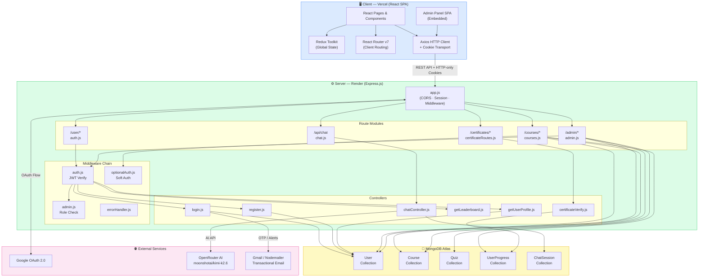

# 🏗️ FinLearn — Architecture Documentation

> A gamified financial literacy platform making financial education engaging through interactive courses, XP systems, and AI assistance.

---

## 📋 High-Level System Overview

FinLearn follows a **monorepo, full-stack SPA architecture** with a strict client/server separation:

- The **React SPA (client)** is deployed on **Vercel** and communicates with the backend via REST API + HTTP-only cookies.
- The **Express.js API (server)** runs on **Render** (Node.js), connects to **MongoDB Atlas**, and integrates with Google OAuth, OpenRouter AI, and Nodemailer.
- A **cross-domain OAuth cookie problem** (Render ↔ Vercel) is solved via a short-lived JWT exchange-code flow.

---

## 🧰 Technology Stack

### Frontend (`client/`)

| Layer | Technology | Version |
|-------|-----------|---------|
| UI Framework | React | 19.2.6 |
| Build Tool | Vite | 7.1.9 |
| Styling | Tailwind CSS | 4.1.17 |
| Component Library | Material UI | 6.5.0 |
| State Management | Redux Toolkit | 2.11.1 |
| Routing | React Router DOM | 7.10.1 |
| Animations | Framer Motion | 12.38.0 |
| Charts | Chart.js + Recharts | 4.5.1 / 3.8.1 |
| Form Handling | Formik + Yup | 2.4.9 / 1.7.1 |
| HTTP Client | Axios | 1.7.2 |
| Math Rendering | KaTeX | 0.16.45 |
| Rich Text | React Quill New | * |

### Backend (`server/`)

| Layer | Technology | Version |
|-------|-----------|---------|
| Runtime | Node.js | 18+ |
| Web Framework | Express.js | 4.21.2 |
| Database ODM | Mongoose | 8.12.1 |
| Authentication | Passport.js + JWT | 0.7.0 / 9.0.2 |
| OAuth Provider | passport-google-oauth20 | 2.0.0 |
| Password Hashing | bcrypt | 5.1.1 |
| Email | Nodemailer | 6.10.0 |
| AI (Chatbot) | OpenAI SDK → OpenRouter | 6.39.0 |
| PDF Generation | PDFKit | 0.13.0 |
| Session | express-session | 1.18.1 |

### Infrastructure

| Service | Purpose |
|---------|---------|
| MongoDB Atlas | Primary database (cloud-hosted) |
| Vercel | Frontend hosting + reverse proxy |
| Render | Backend hosting |
| Google OAuth 2.0 | Third-party authentication |
| OpenRouter AI | AI chatbot (FinBot) via `moonshotai/kimi-k2.6` |
| Gmail / Nodemailer | Transactional email (OTP, password reset) |

---

## 📁 Directory Layout

```
FinLearn/
├── README.md
├── ARCHITECTURE.md         ← This file
├── DATA_FLOW.md
├── API_CONTRACT.md
├── PROJECT_SUMMARY.md
│
├── client/                 ─── React SPA (Vite + Tailwind)
│   ├── index.html          Entry HTML shell
│   ├── vite.config.js      Vite build config + proxy
│   ├── vercel.json         Vercel SPA routing (all → index.html)
│   ├── components.json     shadcn/ui component config
│   ├── jsconfig.json       JS path aliases
│   ├── public/             Static assets (images, favicons, manifest)
│   └── src/
│       ├── main.jsx        React entry point (ReactDOM.createRoot)
│       ├── App.jsx         Root router (all client routes defined here)
│       ├── index.css       Global styles + Tailwind directives
│       │
│       ├── pages/          Full page-level components (one per route)
│       │   ├── Home.jsx            Public landing page
│       │   ├── Dashboard.jsx       Main user dashboard
│       │   ├── AllCourses.jsx      Course catalog
│       │   ├── CourseDetailsPage.jsx Course detail + enroll
│       │   ├── LessonPage.jsx      Lesson content viewer
│       │   ├── QuizPage.jsx        Interactive quiz
│       │   ├── QuizResultsPage.jsx Quiz result + XP animation
│       │   ├── CertificatePage.jsx Certificate download/share
│       │   ├── VerifyPage.jsx      Public certificate verifier
│       │   ├── Progress.jsx        Learning progress tracker
│       │   ├── AnalyticsDashboard.jsx User analytics
│       │   ├── Profile.jsx         User profile + settings
│       │   ├── Tools.jsx           7 financial calculators
│       │   ├── AboutUs.jsx
│       │   ├── Contact.jsx
│       │   ├── HelpCenter.jsx
│       │   ├── PrivacyPolicy.jsx
│       │   └── TermsOfService.jsx
│       │
│       ├── Components/     Reusable feature components
│       │   ├── Auth/       Login, Register, ForgetPassword, Onboarding,
│       │   │               GoogleCallback, Super (route guard), ProtectedAdminRoute
│       │   ├── Chatbot/    FinBotPage (AI chatbot UI)
│       │   └── Dashboard/  CourseContent (lesson player)
│       │
│       ├── admin/          Admin SPA (embedded in main app)
│       │   ├── index.jsx
│       │   ├── pages/      Dashboard, Courses, Users, Analytics,
│       │   │               Reports, Quizzes, Settings
│       │   ├── components/ Admin-specific UI components
│       │   ├── hooks/      Admin data hooks
│       │   └── services/   Admin API calls
│       │
│       ├── context/        React Context providers (auth state, etc.)
│       ├── hooks/          Custom React hooks
│       ├── layouts/        AuthLayout, AdminLayout (structural wrappers)
│       ├── lib/            Utility libraries (axios instance, etc.)
│       ├── utils/          Helper functions (formatters, calculators)
│       └── asset/          Local image/icon assets
│
└── server/                 ─── Express.js REST API
    ├── server.js           Minimal shim → src/server.js
    ├── package.json
    │
    ├── src/
    │   ├── app.js          Express app config: CORS, session, middleware, route mounting
    │   └── server.js       Entry point: DB connect + app.listen
    │
    ├── routes/             API route definitions
    │   ├── auth.js         /user/* — authentication & profile
    │   ├── courses.js      /courses/* — course + progress management
    │   ├── admin.js        /admin/* — admin CRUD (auth+admin guarded)
    │   ├── certificateRoutes.js  /certificates/* — cert issuance & verification
    │   └── chat.js         /api/chat — FinBot AI chatbot
    │
    ├── controllers/        Business logic (one file per operation)
    │   ├── login.js        Email/password login → JWT cookies
    │   ├── register.js     New user registration
    │   ├── logout.js       Clear auth cookies
    │   ├── refreshToken.js Rotate access token via refresh token
    │   ├── setTokenCookies.js  Exchange OAuth code → cookies (Vercel domain fix)
    │   ├── getUserProfile.js   Fetch authenticated user's full profile
    │   ├── updateProfile.js    Update profile fields
    │   ├── uploadProfileImage.js  Base64 profile image handler
    │   ├── getAccess.js    Auth check endpoint (validate session)
    │   ├── forgotPassword.js   Trigger OTP email for password reset
    │   ├── verifyOtp.js    Validate password-reset OTP
    │   ├── updatePassword.js   Set new password post-OTP
    │   ├── getOtpExpTime.js    Return OTP expiry timestamp
    │   ├── sendEmailOtp.js     Send OTP for email change
    │   ├── verifyEmailOtp.js   Confirm new email via OTP
    │   ├── saveOnboarding.js   Persist onboarding answers
    │   ├── skipOnboarding.js   Mark onboarding as skipped
    │   ├── getLeaderboard.js   Compute ranked leaderboard
    │   └── chatController.js   FinBot: OpenRouter AI relay + session persistence
    │
    ├── middlewares/        Express middleware
    │   ├── auth.js         JWT verification (cookie + Bearer header fallback)
    │   ├── admin.js        Admin role check (isAdmin flag)
    │   ├── optionalAuth.js  Soft auth — attaches user if token present, no fail
    │   ├── googleAuth.js   Post-OAuth user upsert (create or find user in DB)
    │   └── errorHandler.js Centralized error response formatter
    │
    ├── models/             Mongoose schemas
    │   ├── User.js         Users (profile, XP, OTP, leaderboard, onboarding)
    │   ├── Course.js       Courses (modules → lessons → quiz questions)
    │   ├── Quiz.js         Standalone quizzes
    │   ├── UserProgress.js Per-user course progress (modules, lessons, XP, certificate)
    │   └── ChatSession.js  FinBot conversation history (sessionId → messages[])
    │
    ├── utils/              Reusable server utilities
    │   ├── generateToken.js   Create access + refresh JWTs
    │   ├── getConnection.js   Mongoose connect with event listeners
    │   ├── googleStrategy.js  Passport Google OAuth setup + OAuth flow routing
    │   ├── sendMail.js        Nodemailer email sender
    │   └── certificateVerify.js  Verification ID generator + certificate payload formatter
    │
    └── scripts/            One-time utility scripts
        ├── seedAdmin.js       Create initial admin user
        └── seedDemoCourses.js Seed demo course data
```

---

## 🗺️ Architecture Diagram



---

## 🔐 Authentication Architecture

FinLearn uses a **dual-token JWT system** with HTTP-only cookies:

| Token | Expiry | Storage | Purpose |
|-------|--------|---------|---------|
| `accessToken` | 7 days | HTTP-only cookie | API request auth |
| `refreshToken` | 30 days | HTTP-only cookie | Rotate access token |

**Cross-Domain OAuth Fix (Render → Vercel):**
1. User hits `/auth/google` on Render
2. After Google OAuth succeeds, Render generates a 60-second `exchangeCode` JWT
3. Browser is redirected to `vercel.app/auth/google/callback?code=<exchangeCode>`
4. React `GoogleCallback` component calls `POST /user/set-token-cookies` through the Vercel proxy
5. Proper `accessToken` + `refreshToken` cookies are set on the Vercel domain

---

## 🎮 Gamification Architecture

```
Lesson Complete → XP Award → User.xp.currentXP += xp
                           → Level-up check (while currentXP >= maxXPForLevel)
                           → maxXPForLevel *= 1.2 per level
Module Complete → XP Award + next module unlocked
Course Complete → isCompleted = true + certificate issued + verificationId generated
```

---

*Generated automatically — reflects codebase as of November 2026.*
