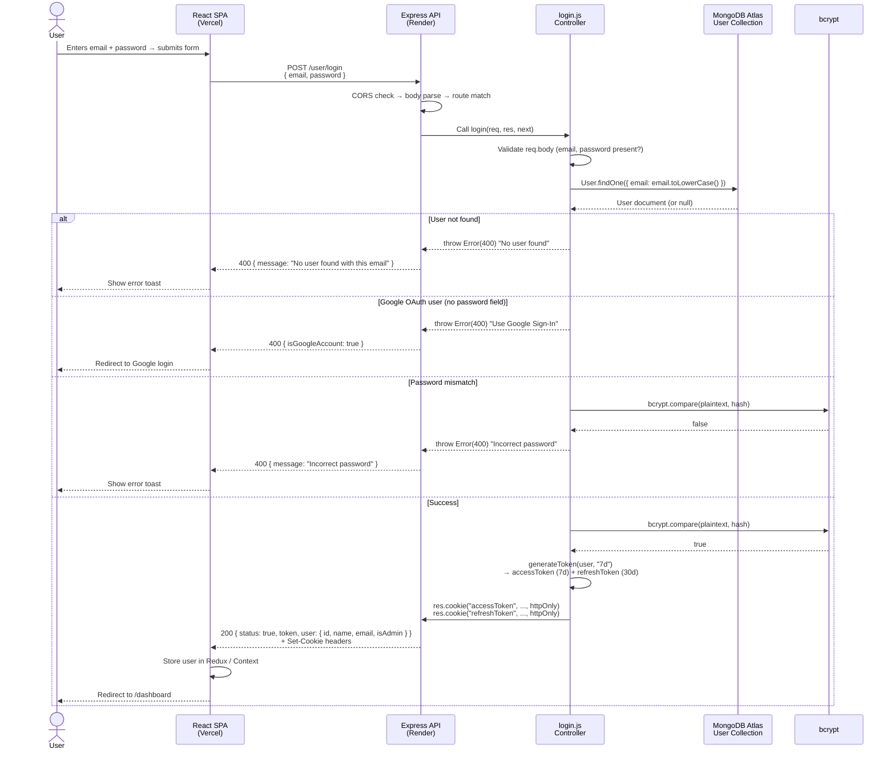
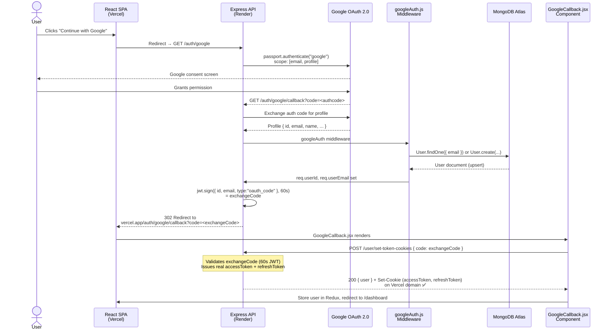
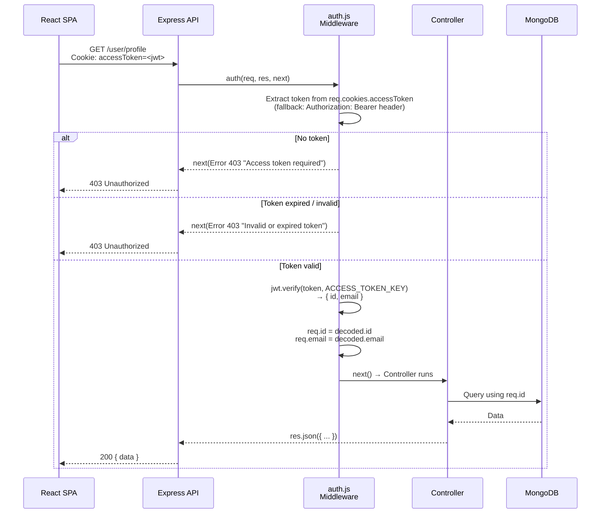
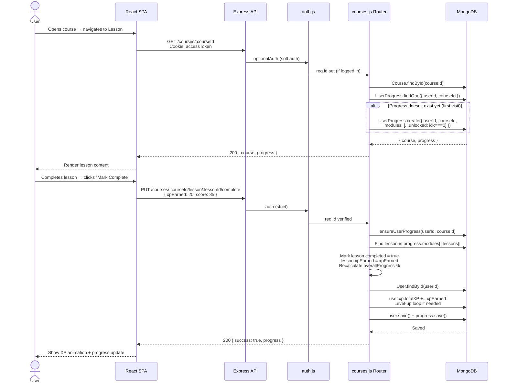
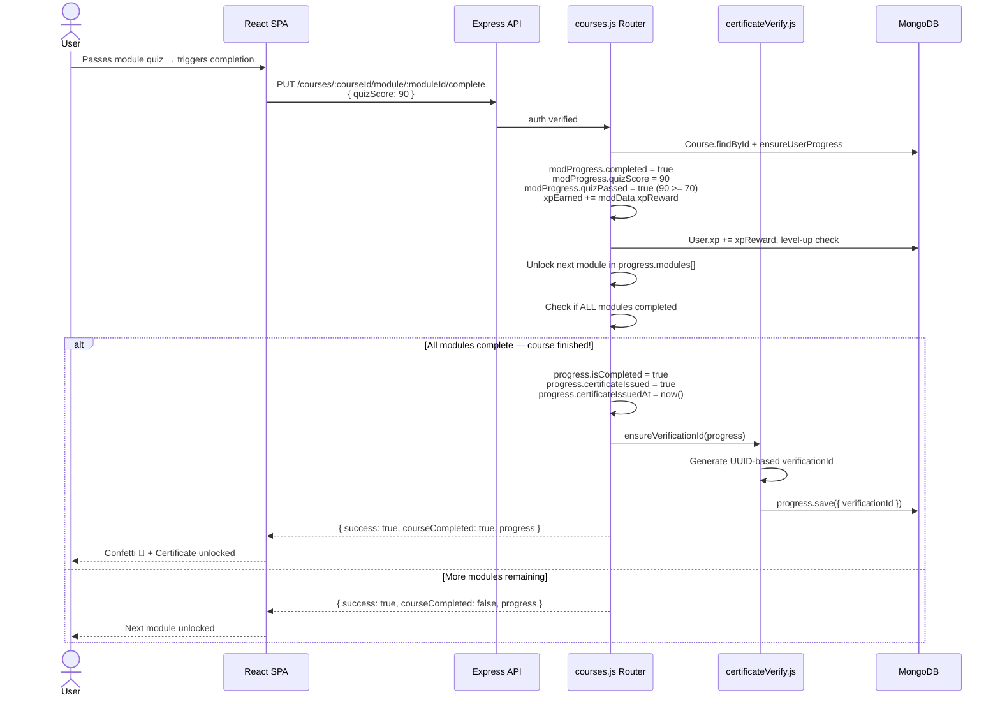
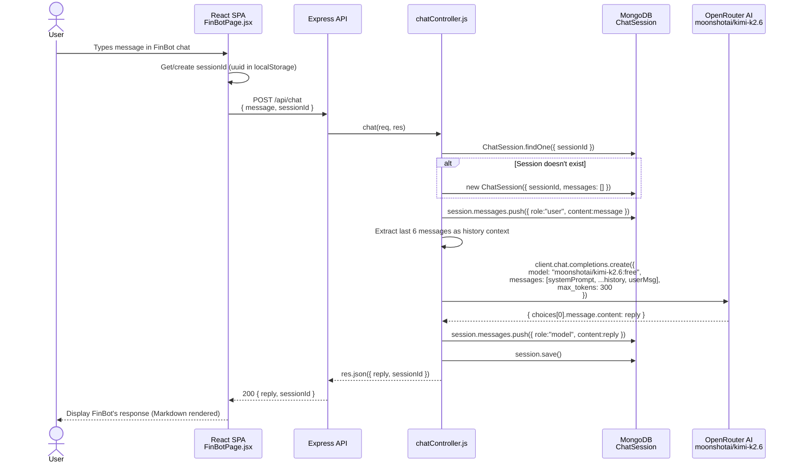
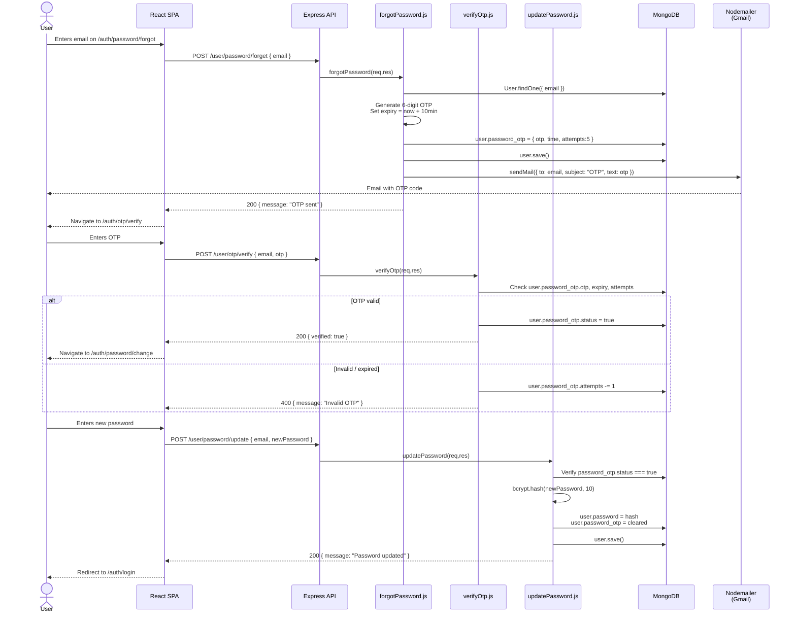
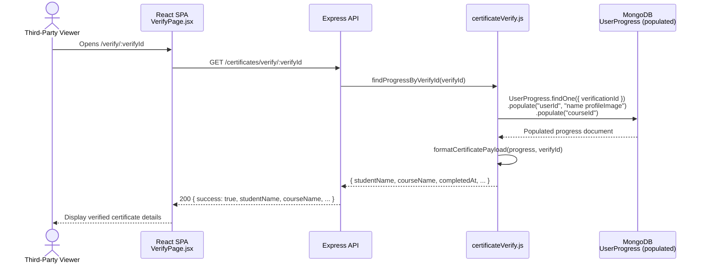

# 🔄 FinLearn — Data Flow Documentation

> Traces the lifecycle of every major request from client browser to database and back.

---

## Overview

All data flows through a standard layered pipeline:

```
Browser → Axios → Express Router → Middleware → Controller → Mongoose → MongoDB Atlas
                                                                       ↓
Browser ← JSON ← Express Response ← Controller ← Mongoose ← MongoDB Atlas
```

External service calls (Google OAuth, OpenRouter AI, Nodemailer) branch off at the **Controller** layer.

---

## 1. 🔐 Standard Login Flow (`POST /user/login`)



---

## 2. 🔑 Google OAuth Flow (Cross-Domain Cookie Fix)



---

## 3. 🔒 Protected API Request (Auth Middleware)



---

## 4. 📚 Course + Lesson Completion Flow



---

## 5. 🏅 Module Completion + Certificate Issuance



---

## 6. 🤖 FinBot AI Chat Flow



---

## 7. 🔑 Password Reset via OTP



---

## 8. 📜 Certificate Verification (Public)



---

## Request Lifecycle Summary

| Phase | Component | Responsibility |
|-------|-----------|---------------|
| 1. Transport | Axios (client) | Add cookies, set Content-Type, handle redirects |
| 2. CORS | app.js | Whitelist Vercel origins, allow credentials |
| 3. Parsing | express.json | Parse JSON body (up to 10 MB) |
| 4. Session | express-session | Manage Passport OAuth session |
| 5. Auth | auth.js / optionalAuth.js | Verify JWT, attach req.id |
| 6. Business Logic | Controller | Query/mutate DB, call external services |
| 7. DB Query | Mongoose | Execute MongoDB query, run validators |
| 8. Response | Controller → Express | Serialize JSON, set status code |
| 9. Error | errorHandler.js | Catch all thrown errors, return consistent shape |

---

*Generated automatically — reflects codebase as of November 2026.*
